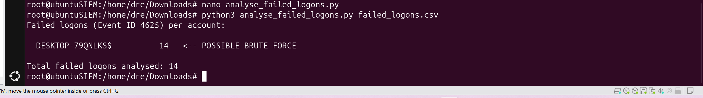

# Python SOC Log Triage - Failed-Logon Analyser

A small Python script that parses a **Splunk CSV export** of Windows failed-logon events (**Event ID 4625**), counts the failures per account, and flags any account over a threshold as a **possible brute-force attempt**. The kind of lightweight automation a SOC analyst writes to speed up a repetitive triage task.

**Tools:** Python 3, Splunk, Windows Security event log
**Skills:** log parsing, scripting for investigation, brute-force detection logic

---

## Why

Reviewing failed logons by hand is slow. This script turns a raw log export into a one-line-per-account summary and highlights the accounts worth investigating first, so an analyst can focus on the signal instead of scrolling through events.

It pairs with my [Splunk SIEM lab](https://github.com/aap-soc/Splunk-SIEM-Lab---Forwarding-Detecting-Windows-Failed-Logons), where the same 4625 events are forwarded from a Windows host into Splunk.

---

## How it works

1. In Splunk, search for failed logons and export the results to CSV:
   ```spl
   index=main sourcetype="WinEventLog:Security" EventCode=4625
   ```
2. Run the script against the export:
   ```bash
   python3 analyse_failed_logons.py failed_logons.csv
   ```

The script:
- reads the CSV with Python's built-in `csv` module,
- handles Splunk's multi-value `Account_Name` field (and falls back to parsing the raw event text if needed),
- counts failures per account with `collections.Counter`,
- prints each account ranked by failure count, flagging any above the threshold.

---

## Example output

```
Failed logons (Event ID 4625) per account:

  DESKTOP-79QNLKS$          14   <-- POSSIBLE BRUTE FORCE

Total failed logons analysed: 14
```



---

## What I learned

- **Automating a triage step.** Counting and ranking failed logons by account is a repetitive task that a short script does instantly and consistently.
- **Real log data is messy.** Splunk exports multi-value fields across lines and some 4625 events record the target account as `-`, so the script has to handle both the clean column and a raw-text fallback.
- **Detection logic is a choice.** The brute-force threshold is a tunable value, which is the same trade-off a real detection rule makes between catching attacks and raising false positives.

---

## Possible next steps

- Enrich the source IP against the **AbuseIPDB API** to add a reputation score.
- Add **4624 (successful logon)** correlation to spot a brute-force that may have succeeded.

---

## Repository

Part of my cybersecurity home-lab portfolio: [github.com/aap-soc](https://github.com/aap-soc)
